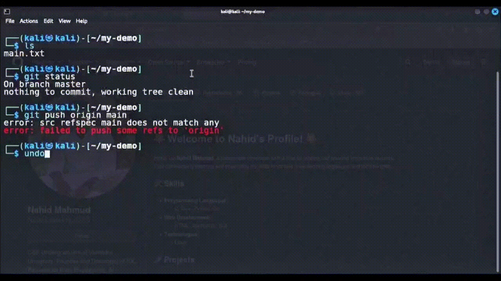

# Term-Undo v6.0

### A Lightweight Zsh Utility for Instant Terminal Error Cleanup and Command Recovery hhhh

# Undo / Alt+u

> Never panic in the terminal again! Instantly undo your last messed-up git command.

<p align="center">
  
</p>


Term-Undo is a lightweight Zsh utility designed to simplify terminal error recovery by clearing unwanted multi-line error output and restoring a previously entered command to the input buffer.

It aims to provide a clean and efficient recovery workflow without duplicating prompts, disrupting the existing Zsh configuration, or deleting command history.

## Quick Usage

Term-Undo provides two ways to initiate command recovery.

| Method | Description |
|---|---|
| Keyboard Shortcut | Press `Alt + U` to trigger terminal cleanup and command recovery. |
| Command Alias | Type `undo` in your terminal to invoke the recovery workflow. |

**Tip:** Recover your previous command without manually retyping it, where supported by the current shell state and implementation.

## One-Line Installation

Install Term-Undo with a single command in your Zsh terminal.

### Installation Command

```bash
curl -fsSL https://raw.githubusercontent.com/nahid-mahmud555/term-undo/main/install.sh | bash
```

### Reload Zsh Configuration

After installation, reload your Zsh configuration:

```bash
source ~/.zshrc
```

This applies the configuration changes to the current shell session.

### 📝 Note for Root Users

Standard users and the superuser (`root`) maintain separate home directories and shell configuration files (`.zshrc`).

- **Standard User:** `/home/username/.zshrc`
- **Root User:** `/root/.zshrc`

Installing **Term-Undo** under a standard user account does not automatically enable it in the root environment.

If your root terminal defaults to Bash, switch to a Zsh session before running the installation commands.

### 📝 Note for Root Users

Standard users and superusers (`root`) maintain separate home directories and shell configuration files (`.zshrc`).

- **Standard User:** `/home/username/.zshrc`
- **Root User:** `/root/.zshrc`

Installing **Term-Undo** under a standard user account does not automatically enable it in the root environment.

If your root terminal defaults to Bash, switch to a Zsh session before running the installation commands.

**Installation for Root Users**

Run the following commands in order:

**Step 1 — Switch to Root Privileges**

```bash
sudo -i
```

**Step 2 — Start a Zsh Session**

```bash
zsh
```

**Step 3 — Install Term-Undo**

```bash
curl -fsSL https://raw.githubusercontent.com/nahid-mahmud555/term-undo/main/install.sh | bash
```

**Step 4 — Reload Root's Zsh Configuration**

```bash
source ~/.zshrc
```

**Note:** Each command is provided separately for easy copying. Make sure you execute them sequentially in the same root session. Term-Undo must be installed and configured separately for the root user and standard user.

**Security note:** Review the installation script before executing a remotely downloaded script through a shell.

## Key Features

### Instant Error Cleanup

Uses terminal control sequences to remove unwanted error output. The number of lines cleared depends on the implementation and the terminal layout.

### Command Buffer Restoration

Designed to restore a previously entered command to the Zsh input buffer, allowing the command to be edited before execution.

### Two-Line Prompt Compatibility

Designed with two-line Zsh prompts in mind, including configurations commonly used in Kali Linux.

### Command History Preservation

Designed to preserve the existing `.zsh_history` file without deleting previously recorded commands.

### Cross-Platform Support

Targets native Linux environments and Windows Subsystem for Linux (WSL/WSL2) running a compatible Zsh configuration.

### Simple Recovery Workflow

Provides keyboard-shortcut and command-based recovery options to reduce manual terminal cleanup and command re-entry.

## Supported Environments

Term-Undo is intended for the following environments, subject to compatibility testing.

| Category | Environments |
|---|---|
| Linux Distributions | Kali Linux, Ubuntu, Debian, Arch Linux, Fedora |
| Windows | WSL and WSL2 |
| Shell | Zsh |
| User Contexts | Standard user and root |
| Prompt Layout | Two-line Zsh prompts |

Compatibility may vary depending on the Zsh version, terminal emulator, key-binding configuration, and installation environment.

## How It Works

The intended recovery workflow consists of the following steps:

1. Execute a command in your Zsh terminal.
2. If the command produces unwanted multi-line error output, initiate Term-Undo using `Alt + U` or the `undo` command.
3. Term-Undo runs its configured terminal cleanup and command-recovery logic.
4. The previous command is restored to the input buffer when recovery is supported by the current implementation.
5. Review, edit, or execute the restored command as needed.

**Result:** A cleaner terminal and a more convenient command-recovery workflow.

## Requirements

- Zsh shell.
- `curl` for the one-line installation method.
- An internet connection during installation.
- A terminal emulator compatible with the configured keyboard shortcut and terminal control sequences.

## Repository

**Project:** Term-Undo v6.0

**Author and Maintainer:** Nahid Mahmud

**GitHub Profile:** [@nahid-mahmud555](https://github.com/Nahid-mahmud555)

**Repository:** [nahid-mahmud555/term-undo](https://github.com/Nahid-mahmud555/term-undo)

**Installation Script:** [install.sh](https://github.com/nahid-mahmud555/term-undo/blob/main/install.sh)

---

### 📅 Release Info
* **Date:** 24 Oct 2026
* **Environment:** Kali Linux (Zsh)

---

# 🚀 Term-Undo v6.0 is Launching on Product Hunt!

We are excited to announce that **Term-Undo v6.0** is officially scheduled to launch on Product Hunt!

📅 **Launch Date:** October 26th, 2026 @ 12:01 AM PDT  
🔗 **Product Hunt Page:** [Term-Undo on Product Hunt](https://www.producthunt.com/products/term-undo?launch=term-undo)

---
> 🔔 **Support the Launch:** Please visit our [Product Hunt Page](https://www.producthunt.com/products/term-undo?launch=term-undo) and click **"Notify Me"** to support us as soon as we go live!


## 📰 Articles & Blog Posts

* 📝 **DEV.to:** [Stop retyping broken commands: Term-Undo clears errors and restores your Zsh buffer with Alt+U](https://dev.to/nahid-mahmud555/stop-retyping-broken-commands-term-undo-clears-errors-and-restores-your-zsh-buffer-with-altu-47cc)


## License

Term-Undo is intended to be released as an open-source project under the MIT License.

See the repository's [LICENSE](LICENSE) file for the complete license terms.

## Final Statement

**Term-Undo v6.0 — Clean Terminal. Quick Recovery.**

A lightweight utility designed to make Zsh command recovery simpler, cleaner, and more efficient.
